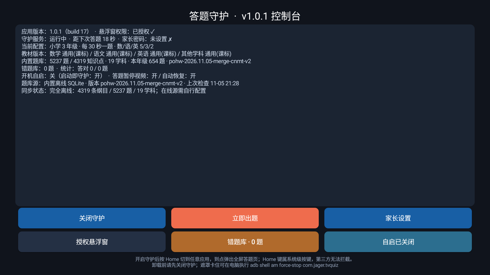
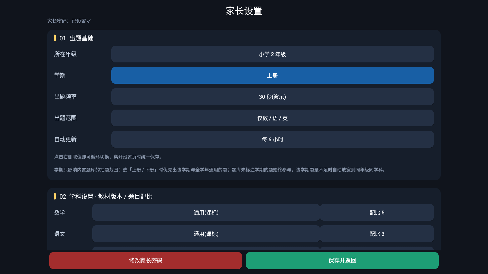

# PoHW · 中文 K12 电视答题守护（增强版）

在 [jagerzhang/PoHW](https://github.com/jagerzhang/PoHW) 基础上做的改造版：给家里的电视加一道「答对才能继续看」的关卡，题库换成了真实可答的中小学题目，并新增**按学期出题**。

原版是 MIT 协议的 Android TV 答题守护：到点弹出全屏题目，答对解锁一段时间，跨应用悬浮、离线可用。这个仓库保留全部原有能力，只改了题库与设置。

**直接下载安装**：[PoHW-cnmt-term-v1.0.1.apk](https://github.com/mastomato/PoHW-CN-K12/releases/download/v1.0.1-cn.1/PoHW-cnmt-term-v1.0.1.apk)（1.79 MB，支持 Android 5.0+，自签名）· [Release 说明](https://github.com/mastomato/PoHW-CN-K12/releases/tag/v1.0.1-cn.1)



## 相对原版的改动

### 1. 新增「学期」选择（上册 / 下册）

原版的 `questions` 表里其实有 `term` 列（上/下/全），但代码从未读取它，抽题 SQL 只有 `grade + subject`。本版把它接上了：

- 设置页 → `01 出题基础` → 新增「学期」一行，可循环切换 `全学年（上下册）/ 上册 / 下册`
- 选上册时抽题谓词追加 `AND (term=? OR term IS NULL OR term='' OR term='全')`
- 兜底顺序：年级+学科+学期 → 学科+学期 → **放宽学期、保住年级与学科** → 学科 → 全库。某个学期题量不足时不会乱跳到别的年级
- 不分学期的题（口算、科学常识）统一标为「全」，两个学期都会出



### 2. 题库重做：5129 → 5735 题

原版内置题库里 **4319 道（84%）是「纲目定位」元数据题**，形如「知识点『写作：面积计算』是哪个年级段的内容？」，答案只是年级标签，而且源数据还串了学科（语文下面挂着「写作：面积计算」）。真正能答的只有 810 道。

本版的处理：

| 来源 | 题数 | 说明 |
|---|---|---|
| 原库真实题 | 810 | 剔除全部 4319 道元数据题 |
| [cn-math-taxonomy](https://github.com/giszh86/cn-math-taxonomy) | 3314 | 四选一选择题，剔除高中题、依赖课文原文的阅读题、带图题、重复选项题 |
| 参数化生成（数学/科学） | 1113 | 口算、单位换算、科学常识，答案由程序计算 |
| **奥数思维（本仓库新增）** | 498 | 20 个专题，答案由公式算出 |
| **合计** | **5735** | 覆盖 1–9 年级，数/语/英/理/科学 |

奥数思维专题：找规律、数线段、和差、和倍、差倍、鸡兔同笼、植树、周期、方阵、盈亏、年龄、平均数、抽屉原理、相遇、追及、工程、浓度、等差数列、容斥原理、余数。

每题都满足电视弹窗的硬约束：**题干 ≤ 60 字、无图、四选一、带一行解析**。干扰项取常见错解（差一、忘除以 2、少加 1、按原溶液算），不是随机数。

```
笼子里鸡和兔共 23 个头、78 只脚，兔有多少只？
A. 7   B. 16   C. 17   D. 23        解析：兔=(78−2×23)÷2=16
```

### 3. 零 Gradle 本地构建链

原仓库的 `app/build.sh` 需要 JDK 17 + Android SDK。本仓库补了 `tools/local/build_apk.sh`，用 aapt2 → javac → d8 → zipalign → apksigner 全流程出包，并记录了踩过的坑（见 [docs/BUILD-LOCAL.md](docs/BUILD-LOCAL.md)）。

## 安装

```bash
# 已 root 或开启 ADB 调试的电视/盒子
adb connect <电视IP>:5555
adb install -r dist/PoHW-cnmt-term-v1.0.1.apk
```

APK 是**自签名**的（证书与官方不同），如果装过原版必须先卸载：

```bash
adb uninstall com.jager.tvquiz
```

装好后：

1. 打开 App，首次进入家长设置需设置 4–8 位密码
2. 「所在年级」「学期」按孩子实际情况选
3. 「出题频率」= 答对后能看多久，两者是同一个值
4. 需要开机就生效的话，打开「开机自启」，并给 App 悬浮窗权限

## 自己构建

```bash
# 需要 JDK 17 + Android SDK（build-tools 34 / platform-33）
export JAVA_HOME=/path/to/jdk17
export ANDROID_HOME=$HOME/Library/Android/sdk
bash tools/local/build_apk.sh
```

题库重建需要原始题库与 cn-math-taxonomy 的 JSON（体积原因未入库），详见 `tools/local/` 下的脚本头注释。

## 已知限制

- **学期只作用于内置题库**。`05 在线题库源` 的题包格式没有学期字段，配了在线源后那部分不按学期筛。
- 初中语文只有 30 题（cn-math-taxonomy 的语文只覆盖小学 1–6 年级），一年级英语也只有 30 题（该库英语从三年级起）。
- 奥数题混在数学池里出，题目标签带「思维·xxx」前缀；没有独立开关。
- 「暂停视频 / 恢复播放」是 best-effort（音频焦点 + 媒体键），不保证所有播放器响应。

## 许可

- 本仓库代码沿用上游 **MIT**，见 [LICENSE](LICENSE)。
- 题库数据涉及第三方来源与各自许可，**务必先读 [NOTICE.md](NOTICE.md)**。其中 cn-math-taxonomy 部分为 **CC BY-NC 4.0（禁止商业使用）**。

上游项目：[jagerzhang/PoHW](https://github.com/jagerzhang/PoHW)（MIT）。本仓库与原作者的立场无关，问题请提到本仓库。
